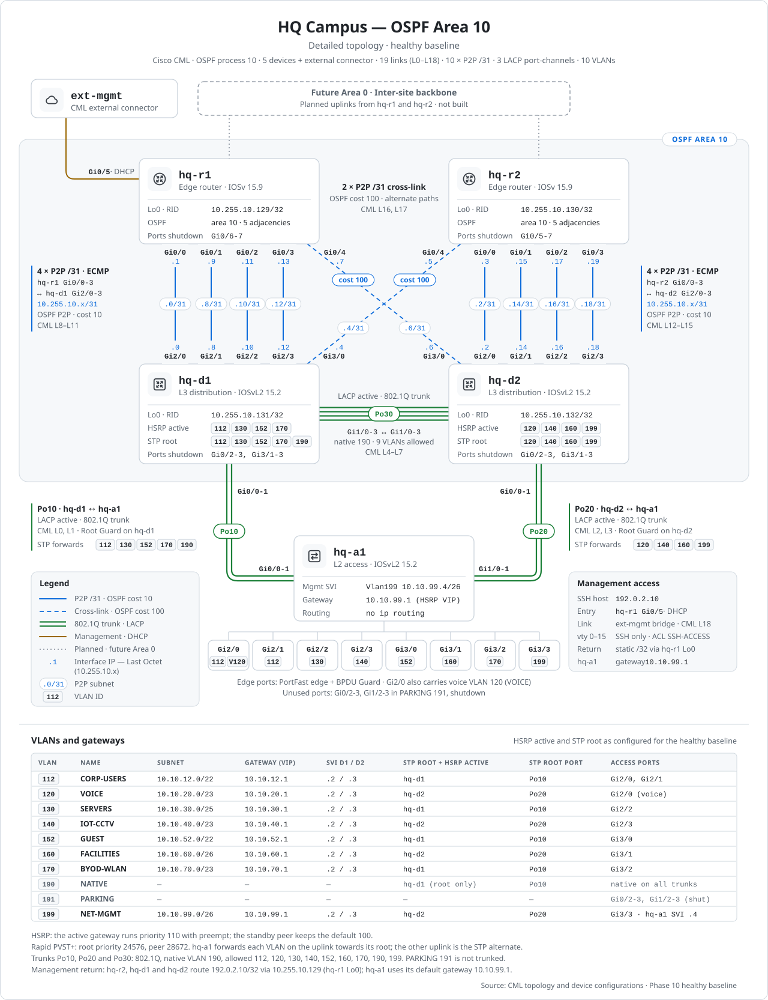

# Network Diagrams

[Portfolio](../README.md) / Network Diagrams

| Diagram | Supporting document |
|---|---|
| [High-level HQ campus topology](#high-level-topology) | [HQ Campus Design](../docs/hq-campus-design.md) |
| [Detailed HQ campus topology and VLANs](#detailed-topology) | [HQ Campus Design](../docs/hq-campus-design.md) |
| [Physical network topology](../docs/topology.md) | [Network Plan](../docs/network-plan.md) |

## High-level topology

The five-device HQ campus, the OSPF Area 10 routed connections and the EtherChannel layout.

<picture>
  <source media="(prefers-color-scheme: dark)" srcset="hq-campus-area10-topology-dark.svg">
  
</picture>

[Open high-level SVG at full size](hq-campus-area10-topology.svg) · [Dark version](hq-campus-area10-topology-dark.svg) · **[Continue to detailed topology ↓](#detailed-topology)**

---

## Detailed topology

Interface and /31 addressing, VLAN allocations, gateway roles, STP root-port selection and management connections. Open the full-size SVG to read the smaller labels.

<picture>
  <source media="(prefers-color-scheme: dark)" srcset="hq-campus-area10-topology-detailed-dark.svg">
  
</picture>

[Open detailed SVG at full size](hq-campus-area10-topology-detailed.svg) · [Dark version](hq-campus-area10-topology-detailed-dark.svg) · [↑ High-level topology](#high-level-topology)

---

[↑ Portfolio](../README.md) · [HQ Evidence Map](../evidence/hq/README.md)
