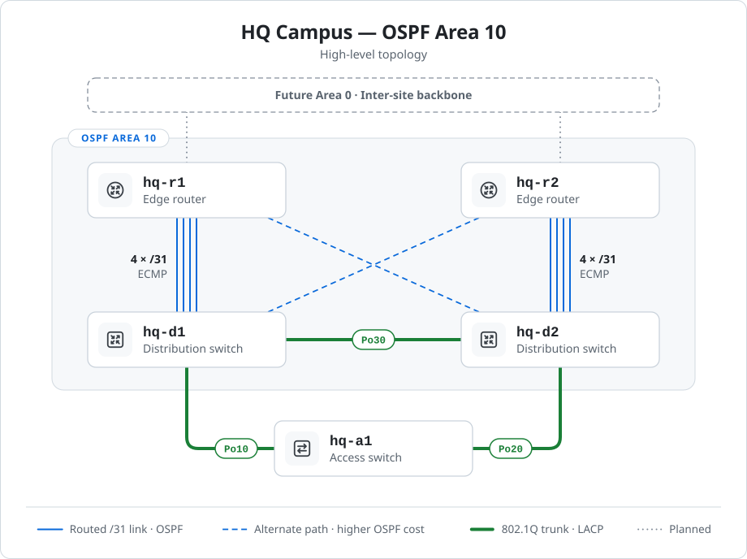

# HQ Campus Design

[Portfolio](../README.md) / [HQ Implementation](implementation/hq/README.md) / HQ Campus Design

## Contents

| No. | Section |
|---:|---|
| 1 | [Overview](#1-overview) |
| 2 | [High-Level Topology](#2-high-level-topology) |
| 3 | [VLAN and Gateway Design](#3-vlan-and-gateway-design) |
| 4 | [Layer 3 Infrastructure Addressing](#4-layer-3-infrastructure-addressing) |
| 5 | [Layer 2 Design](#5-layer-2-design) |
| 6 | [HSRP and Rapid PVST+ Design](#6-hsrp-and-rapid-pvst-design) |
| 7 | [OSPF Area 10 and ECMP Design](#7-ospf-area-10-and-ecmp-design) |
| 8 | [Design Rationale](#8-design-rationale) |
| 9 | [Current Design Status](#9-current-design-status) |
| 10 | [Next Design Phase](#10-next-design-phase) |

**Project:** Multi-Site Cisco CML Lab

**Site:** HQ Campus

**Status:** HQ campus design implemented and verified through Phase 09; Phase 10 testing complete with findings; Phase 11 acceptance in progress

**Routing domain:** OSPF Area 10

**Node count:** 5 network devices

This document describes the HQ architecture and the engineering decisions behind it. Implementation detail, verification evidence, troubleshooting and findings are documented separately. The original design intent is retained rather than revised retrospectively to reflect later testing.

## 1. Overview

I have designed the HQ campus around five devices in a two-tier collapsed-core layout. The two multilayer distribution switches provide the campus gateways and routing, while the access switch connects to both of them. Two edge routers complete the HQ routing topology.

The five devices are:

- hq-r1 — Edge Router 1
- hq-r2 — Edge Router 2
- hq-d1 — Multilayer Distribution Switch 1
- hq-d2 — Multilayer Distribution Switch 2
- hq-a1 — Access Switch

HQ uses OSPF Area 10 for its internal routing. The edge routers will later connect this area to the Area 0 backbone when the branch network and inter-site connectivity are introduced.

The design combines several features:

- LACP EtherChannels for access and distribution connectivity.
- Rapid PVST+ and HSRP for spanning-tree control and gateway redundancy.
- Independent routed /31 links, OSPF ECMP and higher-cost alternate paths.
- VLSM addressing, /32 loopbacks and dedicated native and parking VLANs.

I kept Layer 2 and Layer 3 redundancy separate. LACP combines physical links into logical Layer 2 connections, while OSPF uses independent routed interfaces to provide multiple paths between devices. This distinction also gives each mechanism a clearly defined role within the design.

Monitoring, security controls, inter-site connectivity and automation will be introduced as the wider project develops.

[↑ Back to Contents](#contents)

---

## 2. High-Level Topology

The diagram below shows the HQ campus and its connections.

*HQ Campus topology — OSPF Area 10*

I designed the five-node HQ topology to retain redundancy at both the campus gateway and the routed edge. Combining the core and distribution functions on two multilayer switches kept the gateways and campus routing on separate devices without requiring another tier. Retaining two edge routers also allowed me to investigate routed-path and device failures, with both routers available for the later Area 0 backbone. The interface allocation accommodates these connections while leaving spare ports for future phases.

The trade-off was a single access switch. I could provide hq-a1 with redundant uplinks, but the topology would not protect its connected endpoints against failure of hq-a1 itself. With five nodes available, I kept the distribution and edge pairs and accepted that access-layer limitation.

I connected hq-a1 independently to hq-d1 through Po10 and to hq-d2 through Po20 so that access connectivity did not depend on one distribution switch. Po30 provides the direct Layer 2 connection between the distribution switches, carrying the campus VLANs and supporting communication between the gateway peers. Together, these connections allow an alternative access path without necessarily requiring the gateway role to move.

I divided the preferred HSRP Active roles between the distribution switches so that both participate in normal forwarding. Aligning the preferred spanning-tree root with gateway ownership directs each VLAN towards its intended gateway and reduces unnecessary forwarding across Po30. The detailed role assignments and recovery policies remain in Sections 3 and 6.

My [14 September proposal](https://github.com/ddduddden/multi-site-cml-lab/blob/1a6c994ed/docs/hq-campus-design.md#layer-3-etherchannel-design) used routed EtherChannels Po101 and Po201 between the primary distribution and edge pairs. On [15 September](https://github.com/ddduddden/multi-site-cml-lab/blob/0547b4648/docs/hq-campus-design.md#7-ospf-area-10-and-ecmp-design), I revised this to four independent routed /31 interfaces between hq-d1 and hq-r1, and another four between hq-d2 and hq-r2. These replaced the proposed routed Port-Channels. Each routed interface can form its own OSPF adjacency. Where the total OSPF path costs are equal, multiple direct links can be installed as ECMP next hops. LACP remains on the switched campus connections. This separation lets me investigate EtherChannel member resilience and routed-link reconvergence as distinct behaviours.

The diagonal links from hq-d1 to hq-r2 and hq-d2 to hq-r1 give each distribution switch a routed connection beyond its directly paired router. They retain alternative paths through the remaining topology when preferred connectivity is lost. I chose explicit OSPF costs to make path preference deliberate and consistent across equivalent links, with the higher-cost connections available where the complete route calculation selects them. Section 7 defines that policy.

I included these choices before the phased implementation because I wanted to test different failures independently and then examine their combined effects. Losing one bundle member, a complete access uplink, a gateway, an individual routed link or an entire direct path set should ask different questions of the network. Restoring each failed device or connection also allows the return to the preferred arrangement to be checked. The detailed test procedures developed during the build; the intention to make those failures meaningful was already part of the architecture.

[↑ Back to Contents](#contents)

---

## 3. VLAN and Gateway Design

### VLAN and VLSM Addressing Plan

**Site allocation:** 10.10.0.0/16

**OSPF area:** Area 10

**HSRP addressing convention:** .1 = HSRP virtual IP, .2 = hq-d1, .3 = hq-d2 for each routed VLAN.

| **VLAN** | **Name**   | **Function**                      | **IPv4 Prefix** | **Usable Hosts** | **HSRP Virtual IP** |
|----------|------------|-----------------------------------|-----------------|------------------|---------------------|
| 112      | CORP-USERS | Corporate users                   | 10.10.12.0/22   | 1022             | 10.10.12.1          |
| 120      | VOICE      | IP telephony                      | 10.10.20.0/23   | 510              | 10.10.20.1          |
| 130      | SERVERS    | Server/application services       | 10.10.30.0/25   | 126              | 10.10.30.1          |
| 140      | IOT-CCTV   | IoT and surveillance              | 10.10.40.0/23   | 510              | 10.10.40.1          |
| 152      | GUEST      | Guest access                      | 10.10.52.0/22   | 1022             | 10.10.52.1          |
| 160      | FACILITIES | Printers/facilities               | 10.10.60.0/26   | 62               | 10.10.60.1          |
| 170      | BYOD-WLAN  | BYOD/wireless                     | 10.10.70.0/23   | 510              | 10.10.70.1          |
| 190      | NATIVE     | Dedicated native VLAN             | —               | —                | —                   |
| 191      | PARKING    | Unused ports                      | —               | —                | —                   |
| 199      | NET-MGMT   | Network infrastructure management | 10.10.99.0/26   | 62               | 10.10.99.1          |

#### Address Allocation Rationale

I have allocated 10.10.0.0/16 to HQ user, service and management addressing, retaining the unallocated space for future HQ requirements.

I deliberately designed the subnet allocations to maintain a recognisable relationship between VLAN IDs and IPv4 addresses while respecting VLSM subnet boundaries. For example, VLAN 112 uses 10.10.12.0/22, VLAN 120 uses 10.10.20.0/23, and VLAN 152 uses 10.10.52.0/22.

The subnet sizes are based on the intended requirements of each network rather than assigning a /24 to every VLAN. This provides a consistent addressing scheme while demonstrating VLSM across networks with different capacity requirements.

#### Capacity Rationale

I have allocated /22 networks to CORP-USERS and GUEST because these are the two client segments with the greatest anticipated demand and potential for growth within the HQ design.

Each /22 provides 1,022 usable IPv4 host addresses. This allows room for future expansion without suggesting that either VLAN will initially contain that many devices.

The remaining VLANs use /23, /25 and /26 prefixes to accommodate their different capacity requirements. Together with the /22 allocations, this maintains a structured VLSM addressing scheme without unnecessarily allocating large subnets to smaller networks.

One consideration with the /22 networks is the potential size of their Layer 2 broadcast domains. In a larger production campus, these client networks might instead be divided across several smaller VLANs. I have retained the /22 allocations here to accommodate the anticipated growth of these segments, while recognising the trade-off between subnet capacity and broadcast-domain size.

#### OSPF Summarisation Policy

The wider addressing hierarchy remains:

- HQ user and service networks — 10.10.0.0/16
- Branch user and service networks — 10.20.0.0/16
- Infrastructure and transit addressing — 10.255.0.0/16

Within that hierarchy, the HQ addressing plan is structured so that the Area 0 backbone can learn a simplified view of Area 10 without losing the stable device identities used for management and troubleshooting.

When hq-r1 and hq-r2 later operate as Area Border Routers between Area 10 and Area 0, the intended advertisement policy is:

| **Area 10 prefix type**                | **Internal representation** | **Advertised toward Area 0** | **Treatment**                    |
|----------------------------------------|-----------------------------|------------------------------|----------------------------------|
| HQ user, service, and management VLANs | Individual VLSM prefixes    | 10.10.0.0/16                 | Summarised at the ABRs           |
| HQ routed transit links                | Ten individual /31 networks | 10.255.10.0/27               | Summarised at the ABRs           |
| HQ Loopback0 identities                | Four individual /32 routes  | Four individual /32 routes   | Advertised without summarisation |

The 10.10.0.0/16 summary represents the HQ site addressing block. Individual VLAN prefixes remain visible inside Area 10, while Area 0 receives a single site-level route.

The routed transit links use addresses from 10.255.10.0/27. The ten planned /31 networks consume addresses 10.255.10.0 through 10.255.10.19, leaving 10.255.10.20 through 10.255.10.31 reserved for future HQ Area 10 transit links. The physical interfaces retain their individual /31 prefixes; the /27 is used only as the inter-area summary.

The four Loopback0 addresses remain individual /32 routes. They are stable device identities used for OSPF router IDs, management, troubleshooting, monitoring, and later automation, so retaining their individual reachability is more useful than aggregating them simply because they occupy a contiguous allocation.

This creates a functional hierarchy rather than summarising the entire 10.255.10.0/24 infrastructure block:

- 10.10.0.0/16 — HQ user, service, and management addressing
- 10.255.10.0/27 — HQ Area 10 routed transit allocation
- 10.255.10.128/29 — HQ loopback allocation pool; active addresses advertised individually as /32s

Area 0 infrastructure links will use a separate address range. This keeps each aggregate associated with the area and function it represents and avoids mixing backbone addressing with prefixes summarised from Area 10.

On Cisco IOS, an active OSPF area-range summary installs a Null0 discard route for the aggregate by default. This protects against routing loops for destinations that fall within the advertised summary but have no valid more-specific route. A valid more-specific route continues to take precedence through normal longest-prefix matching.

The summary metric will be explicitly configured and verified on both HQ ABRs when Area 0 is designed. The numerical values are intentionally deferred until the backbone cost model exists so that the summaries participate correctly in the final end-to-end path-selection policy rather than inheriting an arbitrary example value.

### Gateway and SVI Addressing Plan

The gateway addressing convention is standardised across every routed VLAN:

- First usable address — HSRP virtual IP
- Second usable address — hq-d1
- Third usable address — hq-d2

HSRP group numbers match their associated VLAN IDs.

| **VLAN** | **Name**   | **IPv4 Prefix** | **HSRP Group** | **HSRP Virtual IP** | **hq-d1 SVI** | **hq-d2 SVI** | **Preferred Active** |
|----------|------------|-----------------|----------------|---------------------|---------------|---------------|----------------------|
| 112      | CORP-USERS | 10.10.12.0/22   | 112            | 10.10.12.1          | 10.10.12.2/22 | 10.10.12.3/22 | hq-d1                |
| 120      | VOICE      | 10.10.20.0/23   | 120            | 10.10.20.1          | 10.10.20.2/23 | 10.10.20.3/23 | hq-d2                |
| 130      | SERVERS    | 10.10.30.0/25   | 130            | 10.10.30.1          | 10.10.30.2/25 | 10.10.30.3/25 | hq-d1                |
| 140      | IOT-CCTV   | 10.10.40.0/23   | 140            | 10.10.40.1          | 10.10.40.2/23 | 10.10.40.3/23 | hq-d2                |
| 152      | GUEST      | 10.10.52.0/22   | 152            | 10.10.52.1          | 10.10.52.2/22 | 10.10.52.3/22 | hq-d1                |
| 160      | FACILITIES | 10.10.60.0/26   | 160            | 10.10.60.1          | 10.10.60.2/26 | 10.10.60.3/26 | hq-d2                |
| 170      | BYOD-WLAN  | 10.10.70.0/23   | 170            | 10.10.70.1          | 10.10.70.2/23 | 10.10.70.3/23 | hq-d1                |
| 199      | NET-MGMT   | 10.10.99.0/26   | 199            | 10.10.99.1          | 10.10.99.2/26 | 10.10.99.3/26 | hq-d2                |

#### HSRP Policy

The preferred multilayer distribution switch uses an HSRP priority of 110, while the standby multilayer distribution switch uses the default priority of 100. Preemption is enabled on the preferred switch so that it can reclaim the Active role after recovering from a failure.

Gateway ownership is deliberately split between the two multilayer distribution switches:

- hq-d1 is preferred Active for VLANs 112, 130, 152, and 170.
- hq-d2 is preferred Active for VLANs 120, 140, 160, and 199.

The preferred HSRP Active switch for each VLAN is also intended to operate as the Rapid PVST+ root primary for that VLAN. The HSRP Standby switch is intended to operate as the STP root secondary.

This aligns the preferred Layer 2 forwarding path with the active Layer 3 default gateway while allowing both multilayer distribution switches to participate in normal forwarding.

#### Management SVI Allocation

VLAN 199 provides the in-band management subnet for network infrastructure.

The HSRP virtual gateway and multilayer distribution switch SVI addresses are allocated above. hq-a1 uses 10.10.99.4/26 as its permanent in-band management address and 10.10.99.1 as its default gateway.

hq-a1 remains a Layer 2 access switch. Its management SVI provides IP reachability for device administration and does not provide inter-VLAN routing.

#### HSRP Versioning — Forward Design Note

The current HQ convention of matching the HSRP group number to the VLAN ID is compatible with the planned VLANs because every HQ group number falls within the HSRP version 1 range.

When the Branch Campus is designed, the same convention must not be copied automatically without checking the VLAN IDs. If future VLAN IDs exceed 255, HSRP version 2 should be evaluated if the design is to preserve the VLAN-ID-to-HSRP-group-number relationship.

This requirement will be revisited during the Branch Campus design rather than changing the current HQ HSRP design unnecessarily.

### Reserved VLAN Policy

**VLAN 190 — \`NATIVE\`**

- Dedicated non-default native VLAN
- No SVI
- No intended endpoint traffic

**VLAN 191 — \`PARKING\`**

- Reserved for unused ports
- No SVI
- Unused ports are administratively shut down

**VLAN 1**

VLAN 1 carries no production traffic, no infrastructure management traffic, and is not used as the native VLAN.

[↑ Back to Contents](#contents)

---

## 4. Layer 3 Infrastructure Addressing

HQ Layer 3 infrastructure addressing is allocated from 10.255.10.0/24, which forms part of the wider 10.255.0.0/16 infrastructure and transit address space.

Point-to-point routed interfaces use /31 prefixes, while loopback interfaces use /32 addresses.

### Point-to-Point Routed Interface Addressing

For consistency, the lower address in each /31 is assigned to the multilayer distribution switch and the higher address is assigned to the edge router.

I chose four independent routed links between each directly paired distribution switch and edge router to provide multiple equal-cost paths through OSPF.

Two additional cross-connected routed links provide alternate paths and use higher OSPF costs than the direct ECMP links.

| **Link**      | **Distribution Interface** | **Distribution IP** | **Edge Interface** | **Edge IP**     | **Path Role**          |
|---------------|----------------------------|---------------------|--------------------|-----------------|------------------------|
| hq-d1 ↔ hq-r1 | hq-d1 Gi2/0                | 10.255.10.0/31      | hq-r1 Gi0/0        | 10.255.10.1/31  | Direct ECMP            |
| hq-d2 ↔ hq-r2 | hq-d2 Gi2/0                | 10.255.10.2/31      | hq-r2 Gi0/0        | 10.255.10.3/31  | Direct ECMP            |
| hq-d1 ↔ hq-r2 | hq-d1 Gi3/0                | 10.255.10.4/31      | hq-r2 Gi0/4        | 10.255.10.5/31  | Higher-cost cross-link |
| hq-d2 ↔ hq-r1 | hq-d2 Gi3/0                | 10.255.10.6/31      | hq-r1 Gi0/4        | 10.255.10.7/31  | Higher-cost cross-link |
| hq-d1 ↔ hq-r1 | hq-d1 Gi2/1                | 10.255.10.8/31      | hq-r1 Gi0/1        | 10.255.10.9/31  | Direct ECMP            |
| hq-d1 ↔ hq-r1 | hq-d1 Gi2/2                | 10.255.10.10/31     | hq-r1 Gi0/2        | 10.255.10.11/31 | Direct ECMP            |
| hq-d1 ↔ hq-r1 | hq-d1 Gi2/3                | 10.255.10.12/31     | hq-r1 Gi0/3        | 10.255.10.13/31 | Direct ECMP            |
| hq-d2 ↔ hq-r2 | hq-d2 Gi2/1                | 10.255.10.14/31     | hq-r2 Gi0/1        | 10.255.10.15/31 | Direct ECMP            |
| hq-d2 ↔ hq-r2 | hq-d2 Gi2/2                | 10.255.10.16/31     | hq-r2 Gi0/2        | 10.255.10.17/31 | Direct ECMP            |
| hq-d2 ↔ hq-r2 | hq-d2 Gi2/3                | 10.255.10.18/31     | hq-r2 Gi0/3        | 10.255.10.19/31 | Direct ECMP            |

#### /31 Addressing Rationale

The routed point-to-point links use /31 prefixes because each subnet connects exactly two Layer 3 endpoints.

Cisco supports /31 addressing on point-to-point IPv4 links in accordance with RFC 3021. In this use case, both addresses in the /31 are usable by the two endpoints, avoiding the network and broadcast address overhead associated with traditional /30 point-to-point subnets.

Using /31 prefixes therefore reduces infrastructure address consumption while maintaining a simple and repeatable addressing convention.

#### ECMP and Cross-Link Allocation

The eight direct routed links form two four-link equal-cost path sets, connecting hq-d1 to hq-r1 and hq-d2 to hq-r2.

The two cross-connected links use deliberately higher OSPF costs, providing alternate routing paths without joining the preferred four-link ECMP groups.

### Loopback Addressing

Loopback interfaces use /32 addresses and provide stable Layer 3 identities that are independent of individual physical-link state.

| **Device** | **Interface** | **IPv4 Address** | **Purpose**                      |
|------------|---------------|------------------|----------------------------------|
| hq-r1      | Loopback0     | 10.255.10.129/32 | Stable identity / OSPF router ID |
| hq-r2      | Loopback0     | 10.255.10.130/32 | Stable identity / OSPF router ID |
| hq-d1      | Loopback0     | 10.255.10.131/32 | Stable identity / OSPF router ID |
| hq-d2      | Loopback0     | 10.255.10.132/32 | Stable identity / OSPF router ID |

#### Infrastructure Address Allocation Rationale

The low-numbered portion of 10.255.10.0/24 is used for routed point-to-point links, while loopback addresses are allocated separately within the same HQ infrastructure block.

This separation makes transit links and stable device identities easier to distinguish during configuration, verification, and troubleshooting.

Within 10.255.10.0/24 the allocation is:

| **Range**        | **Purpose**                                                                         |
|------------------|-------------------------------------------------------------------------------------|
| 10.255.10.0/27   | HQ routed transit allocation (ten /31 links in use, .20–.31 reserved for expansion) |
| 10.255.10.128/29 | HQ loopback allocation pool (.129–.132 in use)                                      |

The /27 is the transit summary intended for advertisement toward Area 0. The /29 is an administrative allocation only; the active loopbacks are advertised individually as /32 routes. See Section 3 for the advertisement policy.

Other unused addresses within 10.255.10.0/24 remain reserved for future HQ infrastructure requirements rather than being allocated before a defined purpose exists.

Future tunnel-source and Area 0/WAN addressing will be designed during the corresponding project phase rather than being pre-allocated here.

[↑ Back to Contents](#contents)

---

## 5. Layer 2 Design

I have deliberately kept Layer 2 link aggregation and Layer 3 multipath routing separate in the HQ design.

LACP EtherChannels provide link aggregation and member-link resilience across the switched campus connections. The links between the multilayer distribution switches and edge routers remain independent routed interfaces, allowing OSPF to use them as separate equal-cost paths.

### EtherChannel Plan

Three Layer 2 EtherChannels are used within the HQ campus:

| **Port-Channel** | **Connected Devices** | **Physical Member Interfaces**        | **Members** | **Function**                 | **LACP Mode**   |
|------------------|-----------------------|---------------------------------------|-------------|------------------------------|-----------------|
| Po10             | hq-a1 ↔ hq-d1         | hq-a1 Gi0/0-Gi0/1 ↔ hq-d1 Gi0/0-Gi0/1 | 2           | Access-to-Distribution trunk | Active / Active |
| Po20             | hq-a1 ↔ hq-d2         | hq-a1 Gi1/0-Gi1/1 ↔ hq-d2 Gi0/0-Gi0/1 | 2           | Access-to-Distribution trunk | Active / Active |
| Po30             | hq-d1 ↔ hq-d2         | hq-d1 Gi1/0-Gi1/3 ↔ hq-d2 Gi1/0-Gi1/3 | 4           | Distribution trunk           | Active / Active |

Po10 and Po20 provide redundant Layer 2 uplinks from hq-a1 to the two multilayer distribution switches.

Po30 provides the Layer 2 trunk link between hq-d1 and hq-d2.

LACP is used rather than a static EtherChannel so that member-link participation is negotiated dynamically.

The Layer 3 links between the multilayer distribution switches and edge routers are not EtherChannels. Each remains an independent routed interface for OSPF adjacency formation and ECMP.

### Trunk Policy

All HQ campus EtherChannels operate as IEEE 802.1Q trunks.

The trunk policy is standardised as follows:

- VLAN 190 is the configured native VLAN.
- VLAN 191 is reserved as the parking VLAN and is excluded from normal trunk forwarding.
- VLAN 1 carries no production or infrastructure-management traffic and is not used as the native VLAN.
- Allowed VLANs are explicitly defined rather than relying on the default all-VLAN trunk behaviour.

The intended allowed VLAN set is:

112,120,130,140,152,160,170,190,199

Using an explicit allowed-VLAN list limits each trunk to VLANs that have a defined purpose within the HQ design.

### VTP Policy

I chose VTP transparent mode specifically to ensure that the VLAN definitions are included in each switch's running configuration.

The selected IOSvL2 image maintains a separate VLAN database, which is not included when CML extracts the device configuration for a YAML export. Using VTP transparent mode allows the VLAN definitions to be captured within the running configuration and retained when the lab is exported.

This is important for preserving and rebuilding the lab without having to recreate the VLAN database manually.

### Access Switch Port Allocation

hq-a1 remains a Layer 2 access switch. Its physical interfaces are allocated as follows:

| **Port(s)** | **Access VLAN** | **Voice VLAN** | **Function**                     | **Intended State** |
|-------------|-----------------|----------------|----------------------------------|--------------------|
| Gi0/0-Gi0/1 | —               | —              | Po10 members to hq-d1            | Enabled            |
| Gi0/2-Gi0/3 | 191             | —              | Unused / parking                 | Shutdown           |
| Gi1/0-Gi1/1 | —               | —              | Po20 members to hq-d2            | Enabled            |
| Gi1/2-Gi1/3 | 191             | —              | Unused / parking                 | Shutdown           |
| Gi2/0       | 112             | 120            | Corporate workstation + IP phone | Enabled            |
| Gi2/1       | 112             | —              | Corporate workstation            | Enabled            |
| Gi2/2       | 130             | —              | Server/application endpoint      | Enabled            |
| Gi2/3       | 140             | —              | IoT/CCTV endpoint                | Enabled            |
| Gi3/0       | 152             | —              | Guest endpoint                   | Enabled            |
| Gi3/1       | 160             | —              | Printer/facilities endpoint      | Enabled            |
| Gi3/2       | 170             | —              | BYOD/WLAN test endpoint          | Enabled            |
| Gi3/3       | 199             | —              | Network-management endpoint      | Enabled            |

Unused access interfaces are assigned to VLAN 191 and administratively shut down.

The access-port allocation reflects the intended 16-interface GigabitEthernet switch model.

### Interface Capacity Reservation

The final HQ node layout deliberately retains unused GigabitEthernet interfaces so later phases do not require rebuilding the CML nodes simply to add a new connection.

| **Device**   | **Reserved Interfaces** | **Intended Use**                                                            |
|--------------|-------------------------|-----------------------------------------------------------------------------|
| hq-d1, hq-d2 | Gi0/2-Gi0/3             | Available for future access/distribution EtherChannel expansion if required |
| hq-d1, hq-d2 | Gi3/1-Gi3/3             | Spare capacity for later HQ infrastructure requirements                     |
| hq-r1, hq-r2 | Gi0/5-Gi0/7             | Reserved for future Area 0, WAN, cloud, or backbone connectivity            |

Unused interfaces remain unconfigured or are administratively disabled until a defined requirement exists.

[↑ Back to Contents](#contents)

---

## 6. HSRP and Rapid PVST+ Design

Section 3 defines the HSRP addressing, priorities and preemption policy. I have aligned the Rapid PVST+ root placement with the preferred HSRP Active gateway for each VLAN to provide a more direct Layer 2 forwarding path and reduce unnecessary traffic across Po30 during normal operation.

### HSRP and STP Role Alignment

The preferred HSRP and spanning-tree roles are split between the two multilayer distribution switches as follows:

| **VLANs**       | **hq-d1 Intended Role**           | **hq-d2 Intended Role**           |
|-----------------|-----------------------------------|-----------------------------------|
| 112,130,152,170 | HSRP Active / STP Root Primary    | HSRP Standby / STP Root Secondary |
| 120,140,160,199 | HSRP Standby / STP Root Secondary | HSRP Active / STP Root Primary    |

For example, VLAN 112 uses hq-d1 as its preferred gateway and spanning-tree root. Under normal conditions, hq-a1 should therefore forward traffic towards that gateway through Po10. VLAN 120 follows the opposite arrangement, with hq-d2 preferred and Po20 providing the direct Layer 2 path.

### Native VLAN STP Placement

VLAN 190 is the dedicated native VLAN used across the HQ campus trunks. It has no SVI or HSRP gateway, but it still participates in spanning tree and requires a defined root bridge.

| **VLAN** | **Function** | **hq-d1 STP Role** | **hq-d2 STP Role** |
|----------|--------------|--------------------|--------------------|
| 190      | Native VLAN  | Root Primary       | Root Secondary     |

I have selected hq-d1 as the root primary for VLAN 190, with hq-d2 as the secondary.

Unlike the routed VLANs, there is no active Layer 3 gateway to align with. This assignment simply provides predictable root placement rather than attempting to optimise a gateway forwarding path.

VLAN 191 is reserved for unused access ports. These interfaces are administratively shut down, and VLAN 191 is excluded from the normal trunk allowed list. It therefore does not require a campus-wide spanning-tree root assignment.

### Rapid PVST+ Policy

I have selected Rapid PVST+ as the spanning-tree protocol for the HQ campus. Its separate spanning-tree instances allow root bridge placement to be controlled independently for each VLAN, supporting the decision to divide the preferred HSRP gateway roles between the two distribution switches.

The physical access and distribution connections form a Layer 2 topology that requires loop prevention. Rapid PVST+ determines which logical connections forward traffic for each VLAN and which remain in an alternate or discarding state.

Po10, Po20 and Po30 participate in this topology as logical Port-Channels. Their individual LACP member interfaces are not treated as separate spanning-tree paths. The independent routed links towards the edge routers are outside the Layer 2 spanning-tree topology.

The design uses Cisco's root primary and root secondary configuration method rather than assigning arbitrary bridge-priority values to every VLAN. This provides a consistent way to establish the preferred root hierarchy.

Root Guard is also included on the distribution-switch Port-Channels facing the access layer:

- hq-d1 — Po10
- hq-d2 — Po20

I have included Root Guard to prevent superior BPDUs received from the access layer from changing the intended distribution-layer root hierarchy.

If superior root information is received on a protected Port-Channel, Root Guard places the affected VLAN into a root-inconsistent state rather than allowing that port to become a root port. This protects the intended root placement, although forwarding through the affected port is blocked while that condition exists.

Root Guard is not applied to Po30 because it is the direct connection between the two distribution switches and forms part of their intended spanning-tree topology.

MST is outside the scope of the HQ design and remains a possible subject for a later design exercise.

### Intended Behaviour During Topology Changes

The preferred HSRP and Rapid PVST+ roles describe the normal operating arrangement. They are not a guarantee that the two protocols will change roles together during every failure.

HSRP is responsible for first-hop gateway availability, while Rapid PVST+ controls the Layer 2 forwarding topology. A change in HSRP ownership does not automatically change the spanning-tree root, and a spanning-tree topology change does not automatically trigger an HSRP failover.

The design provides alternative access-to-distribution connections, but continued forwarding depends on the remaining topology and the independent protocol states.

The design aims to maintain predictable forwarding during normal operation while providing alternative paths following a link or device failure, where the remaining topology permits.

The actual response to failures is addressed separately in the verification and engineering-review documentation.

[↑ Back to Contents](#contents)

---

## 7. OSPF Area 10 and ECMP Design

The HQ campus uses OSPFv2 Area 10 for its internal Layer 3 routing. This separates HQ from the planned Branch Campus Area 20, with both sites connecting through the future Area 0 backbone.

OSPF process ID 10 is used consistently across the HQ devices.

The two HQ edge routers will operate as Area Border Routers (ABRs) when the Area 0 backbone is introduced. The planned inter-area summarisation policy is defined in Section 3.

### OSPF Router Identity

Each Layer 3 device uses its Loopback0 address from Section 4 as an explicitly configured OSPF router ID.

I have chosen fixed router IDs rather than relying on automatic selection from the available interface addresses. This provides a consistent OSPF identity for each device, independent of which physical interfaces are operational.

The same loopback addresses are also intended to support management, monitoring and future automation, providing a common reference for each Layer 3 device.

### OSPF Interface Participation

I have selected a passive-by-default OSPF policy, enabling OSPF individually on the required interfaces rather than relying on broad network statements. Only the ten routed /31 links between the distribution switches and edge routers are made non-passive, allowing them to exchange OSPF Hello packets and establish neighbour adjacencies. The VLAN SVIs and loopbacks remain passive, allowing their connected prefixes to be advertised into Area 10 without sending Hello packets or forming OSPF adjacencies.

| **Interface Type**                    | **Area** | **OSPF Adjacency** | **Policy**                         |
|---------------------------------------|----------|--------------------|------------------------------------|
| Routed Distribution-to-Edge /31 links | 10       | Yes                | Non-passive                        |
| Routed user/service SVIs              | 10       | No                 | Passive, prefix advertised         |
| VLAN 199 management SVI               | 10       | No                 | Passive, prefix advertised         |
| Loopback0                             | 10       | No                 | Passive, /32 advertised            |
| VLAN 190 native VLAN                  | —        | No                 | No Layer 3 interface / not in OSPF |
| VLAN 191 parking VLAN                 | —        | No                 | No Layer 3 interface / not in OSPF |

### Distribution-to-Distribution Routing Scope

hq-d1 and hq-d2 do not form a direct OSPF adjacency with each other.

Po30 is a Layer 2 trunk carrying the campus VLANs. Although both distribution switches have routed SVIs for these VLANs, the interfaces remain passive in OSPF and are not intended to provide an additional OSPF transit connection.

HSRP and the routed OSPF cross-links serve different purposes within the design.

HSRP provides first-hop gateway redundancy for the campus VLANs. The higher-cost routed cross-links provide alternative Layer 3 paths when preferred routed connectivity to an edge router is lost.

Neither mechanism replaces the other. HSRP does not create an alternate OSPF transit path, while the availability of an OSPF route does not determine which distribution switch is Active for an HSRP group.

### Routed-Link OSPF Network Type

I have selected the OSPF point-to-point network type for the ten routed links between the distribution switches and edge routers.

Each link connects two OSPF devices, so there is no requirement for a DR/BDR election. The point-to-point network type is applied at both ends of every routed link.

### OSPF Cost and ECMP Policy

The HQ routing design uses explicit OSPF interface costs rather than relying on costs derived from interface bandwidth.

I chose this approach so that the preferred routing paths are determined by the topology design, with consistent costs across equivalent links.

Each primary Distribution-to-Edge connection consists of four independent routed interfaces with equal OSPF costs. The two cross-connected links have higher costs, providing an alternative route when the preferred direct paths are unavailable.

| **Path Set**  | **Links** | **OSPF Cost per Interface** | **Intended Role**          |
|---------------|-----------|-----------------------------|----------------------------|
| hq-d1 ↔ hq-r1 | 4         | 10                          | Direct equal-cost path set |
| hq-d2 ↔ hq-r2 | 4         | 10                          | Direct equal-cost path set |
| hq-d1 ↔ hq-r2 | 1         | 100                         | Higher-cost cross-link     |
| hq-d2 ↔ hq-r1 | 1         | 100                         | Higher-cost cross-link     |

The interface costs of 10 and 100 are administrative values. They are not intended to represent the physical bandwidth of the connections.

The four direct links within each pair have identical costs so they can participate in equal-cost multipath routing where the total route costs are equal.

The cross-links use a substantially higher cost to favour the direct connections under normal conditions. OSPF considers the accumulated cost to a destination, so the preferred route depends on the complete path rather than the cost of an individual interface alone.

The maximum number of equal-cost paths is explicitly set to four. This matches the four-link direct path sets and avoids relying on the selected platform's default ECMP limit.

When the Area 0 backbone is introduced, the end-to-end cost model will need to account for the new backbone interfaces and inter-area summary metrics. The intention is to preserve the preferred and alternate routing hierarchy without assigning arbitrary costs before the wider topology has been designed.

### Area 0 Summarisation

When the Area 0 backbone is introduced, hq-r1 and hq-r2 will operate as ABRs, advertising the HQ summary routes defined in Section 3.

The summarisation policy is designed to reduce the number of routes advertised into the backbone while retaining individual /32 routes for the device loopbacks.

I have deliberately left the final summary metrics undecided until the Area 0 backbone is designed. These costs will need to support the intended routing preferences across the complete multi-site network.

### ECMP Forwarding Behaviour

OSPF calculates the lowest-cost paths to a destination. Where multiple paths have the same total cost, the HQ design allows up to four equal-cost next hops to be installed in the routing table.

ECMP load balancing is handled by the forwarding process rather than OSPF itself. Cisco Express Forwarding (CEF) commonly uses a hashing algorithm to select a next hop, meaning packets belonging to the same traffic flow may follow one path while other flows use different paths.

Therefore, having four equal-cost routes installed does not guarantee that traffic will be distributed evenly across all four links. The actual distribution depends on the forwarding behaviour supported by the selected CML image.

### Intended Behaviour During Routed-Link Failures

Under normal conditions, the four direct links within each primary Distribution-to-Edge connection are intended to provide up to four equal-cost next hops for routes using that path set.

If one direct routed link becomes unavailable, OSPF should remove the affected next hop and calculate routes using the remaining available paths.

A complete loss of the preferred direct path set is intended to make the higher-cost cross-connected route available as an alternative, provided the remaining network topology still supports a valid path to the destination.

When the preferred direct connectivity returns, OSPF is intended to select the lower-cost paths again once the required adjacencies and routing information have been re-established.

The design does not assume that every combination of failures can be accommodated. Continued connectivity depends on the remaining Layer 3 topology, the available routes and the Layer 2 connectivity needed to reach the destination networks.

The timing of these routing changes, the number of installed next hops and the forwarding behaviour under failure conditions belong to the implementation and verification stages.

The objective of this routing design is to provide predictable path preference, multiple equal-cost direct connections and higher-cost alternatives without depending on individual physical links for all Layer 3 connectivity.

[↑ Back to Contents](#contents)

---

## 8. Design Rationale

The following table summarises the main design decisions and the reasoning behind them. The technical details and addressing policies are covered in the preceding sections.

| **Design Decision**                           | **Rationale**                                                                                                                                                                                                    |
|-----------------------------------------------|------------------------------------------------------------------------------------------------------------------------------------------------------------------------------------------------------------------|
| Two-tier collapsed core                       | Provides redundant distribution and gateway roles within the five-device HQ topology, while accommodating the CML node limit.                                                                                    |
| LACP at Layer 2                               | Provides link aggregation and member-link resilience across the switched campus connections.                                                                                                                     |
| OSPF ECMP at Layer 3                          | Allows multiple equal-cost next hops across independent routed interfaces, rather than using EtherChannel for the Layer 3 connections.                                                                           |
| Higher-cost cross-connected routed paths      | Establishes a clear routing preference for the four direct links while retaining higher-cost alternative paths.                                                                                                  |
| VLSM with /31 transit links and /32 loopbacks | Allocates /22, /23, /25 and /26 networks according to the requirements of each VLAN. Separate /31 allocations provide efficient point-to-point addressing, while /32 loopbacks provide stable device identities. |
| Dedicated native and parking VLANs            | Reserves VLAN 190 as the non-default native VLAN and VLAN 191 for unused, administratively disabled access ports, keeping both separate from production endpoint VLANs.                                          |
| HSRP and Rapid PVST+ role alignment           | Aligns the preferred STP root with the Active HSRP gateway to provide direct Layer 2 forwarding paths for each VLAN group.                                                                                       |
| Controlled OSPF neighbour formation           | Uses passive-by-default operation and interface-specific OSPF activation to restrict neighbour formation to the intended routed links.                                                                           |
| Explicit OSPF configuration                   | Uses fixed router IDs, point-to-point network types, manually assigned interface costs and a four-path ECMP limit to maintain consistent routing behaviour without relying on platform defaults.                 |
| Functional inter-area summarisation           | Provides summarised HQ user and transit routes towards Area 0, while retaining individual loopback advertisements for stable device reachability.                                                                |
| Separate implementation evidence              | Maintains a distinction between the original architectural design, device configurations and the findings of subsequent verification.                                                                            |

[↑ Back to Contents](#contents)

---

## 9. Current Design Status

The HQ campus design is defined in Sections 1–8, covering the five-device topology, VLAN and VLSM addressing, Layer 2 connectivity, gateway redundancy and OSPF routing architecture.

The implementation and verification records are maintained separately so that the original design remains distinct from the network's demonstrated behaviour.

| **Area**                           | **Current Status**                                                                                                                                                         | **Supporting Documentation**                                                                                                                              |
|------------------------------------|----------------------------------------------------------------------------------------------------------------------------------------------------------------------------|-----------------------------------------------------------------------------------------------------------------------------------------------------------|
| Platform and Layer 2 design        | Implemented and verified through Phases 01–04, including VLANs, LACP EtherChannels and Rapid PVST+                                                                         | [HQ Verification Plan](implementation/hq/verification-plan.md) |
| Gateway and Layer 3 infrastructure | Implemented and verified through Phases 05–07, including SVIs, HSRP, /31 routed links, loopbacks and OSPF Area 10                                                          | [HQ Verification Plan](implementation/hq/verification-plan.md) |
| ECMP and OSPF cost engineering     | Verified in Phases 08–09, including four-way ECMP, explicit interface costs and preferred routing paths                                                                    | [HQ Verification Plan](implementation/hq/verification-plan.md) |
| Failure and resilience testing     | Phase 10 completed, with successful tests, identified failures and inconclusive outcomes retained in the evidence                                                          | [Phase 10 Evidence Index](../evidence/hq/failure-tests/README.md)      |
| Final configuration and acceptance | Phase 11 in progress. Configuration reconciliation and the sanitised public CML export are recorded; final acceptance remains subject to documentation review and sign-off | [HQ Build Log](implementation/hq/build-log.md)                 |
| Area 0 and inter-site routing      | Design intent only. ABR operation, inter-area summarisation, backbone costs and the Branch Campus remain future work                                                       | Sections 3, 4 and 7                                                                                                                                       |

### Design Scope

The current HQ design covers OSPF Area 10 and the five-device campus topology. It establishes the addressing and routing structure required for later expansion into the multi-site network.

The future Area 0 backbone and Branch Campus Area 20 have not yet been implemented. The planned HQ summarisation policy, individual loopback advertisements and future ABR roles remain architectural decisions rather than verified operational features.

Any changes required as a result of implementation or failure testing are documented separately. The original design is retained so that the reasoning behind the architecture can be understood alongside the later engineering findings.

[↑ Back to Contents](#contents)

---

## 10. Next Design Phase

The next stage of the project will extend the HQ campus into a hybrid physical–virtual networking environment, combining the Cisco CML topology with physical Raspberry Pi devices providing monitoring, logging and network services.

This will provide practical experience integrating and managing network services across virtual and physical infrastructure, including connectivity, monitoring, service redundancy and troubleshooting.

The initial priorities are:

- **Network monitoring and logging:** Use the Raspberry Pi 5 as a dedicated monitoring platform, introducing SNMP monitoring, centralised syslog collection, performance metrics and network visualisation.
- **Redundant DNS services:** Investigate deploying Pi-hole on the Raspberry Pi 5 and the available Raspberry Pi 3B+, providing two DNS servers with consistent configuration and filtering policies.
- **DNS high availability:** Evaluate VRRP using Keepalived to provide a shared virtual IP and automatic failover between the two Raspberry Pis. DNS service health checks and configuration synchronisation will form part of the design.

The Raspberry Pi 5 will provide the main monitoring platform, while the Pi 3B+ offers an additional physical device for DNS redundancy. Pi-hole and VRRP are the initial technologies under consideration; their suitability and the final service arrangement will be determined during the next design stage.

The wider project roadmap includes:

- Layer 2 security controls and access-port protection.
- ACL design based on defined security policies.
- Area 0 backbone and inter-site routing.
- Branch Campus using OSPF Area 20.
- GRE connectivity, progressing to GRE over IPsec.
- Dual-tunnel resilience and WAN failover.
- Wider ECMP and routing resilience scenarios.
- Python and Ansible network automation.

During the GRE phase, tunnel-endpoint reachability will be provided by the underlay rather than learned through the tunnel itself. This keeps the transport path independent of the overlay routes carried across GRE and avoids recursive-routing behaviour.

The HQ design will remain the established baseline for the next stages. Any architectural changes will be documented and justified separately rather than retrospectively altering the original design.

[↑ Back to Contents](#contents)

---

[← HQ Implementation](implementation/hq/README.md) · [↑ Contents](#contents) · [HQ Build Log →](implementation/hq/build-log.md)
