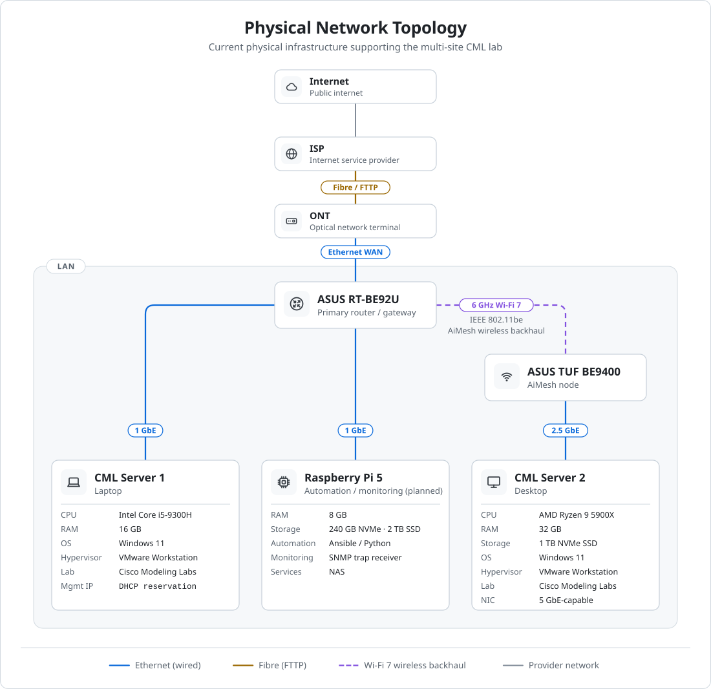

# Physical Network Topology

[Portfolio](../README.md) / [Documentation](README.md) / Physical Network Topology

This diagram represents the current physical infrastructure supporting the multi-site Cisco Modeling Labs environment. The Raspberry Pi 5 is shown as installed hardware; its automation, monitoring and NAS services are planned work. The separate Raspberry Pi 3B+ DNS server is also planned and is not shown as an installed connection.

<picture>
  <source media="(prefers-color-scheme: dark)" srcset="../diagrams/physical-network-topology-dark.svg">
  
</picture>

[Open full-size physical topology](../diagrams/physical-network-topology.svg) · [Dark version](../diagrams/physical-network-topology-dark.svg) · [Network diagram gallery](../diagrams/README.md#physical-network-topology)

## Connectivity Notes

- The ISP connection is delivered using fibre-to-the-premises (FTTP).
- The fibre connection terminates at the ONT.
- The ONT connects to the ASUS RT-BE92U through the WAN interface.
- CML Server 1 connects directly to the primary router using 1 GbE.
- The Raspberry Pi 5 connects directly to the primary router using 1 GbE.
- The ASUS RT-BE92U and ASUS TUF Gaming BE9400 use a 6 GHz Wi-Fi 7 (IEEE 802.11be) AiMesh wireless backhaul.
- The 2.4 GHz radio on the AiMesh node is disabled.
- CML Server 2 connects to the AiMesh node using a 2.5 GbE link.
- CML Server 2 has a 5 GbE-capable network adapter, with the physical link limited by the AiMesh node's 2.5 GbE LAN interface.

---

[↑ Documentation](README.md) · [Lab Environment](environment.md) · [Network Plan](network-plan.md) · [Physical Topology](topology.md)
