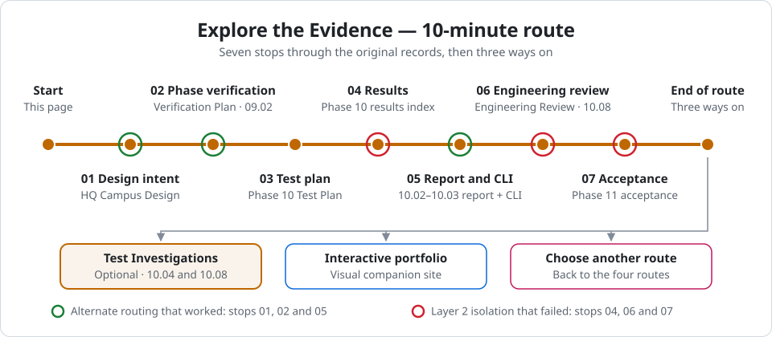

# Explore the Evidence — From Planning to Engineering Review

[Portfolio](../../README.md) / [HQ Evidence Map](README.md) / Explore the Evidence

🟧 **10-MINUTE ROUTE · EXPLORE THE EVIDENCE**

Seven stops through the original HQ records: what the design was meant to do, how each phase was verified, how the failure tests were planned and judged, what they recorded, and what I took from them. Each stop opens the source document at the relevant section, says what to read and roughly how long it takes, then gives you one next step.

<picture>
  <source media="(prefers-color-scheme: dark)" srcset="../../diagrams/explore-the-evidence-route-dark.svg">
  
</picture>

**GitHub is the source of truth.** The interactive site explains the network visually; the plans, results and evidence on this route remain authoritative.

Prefer to follow one test in depth? [Explore the Test Investigations](README.md#explore-the-test-investigations) traces HQ-VP-10.04 (PASS) and HQ-VP-10.08 (FAIL) from plan to evidence.

